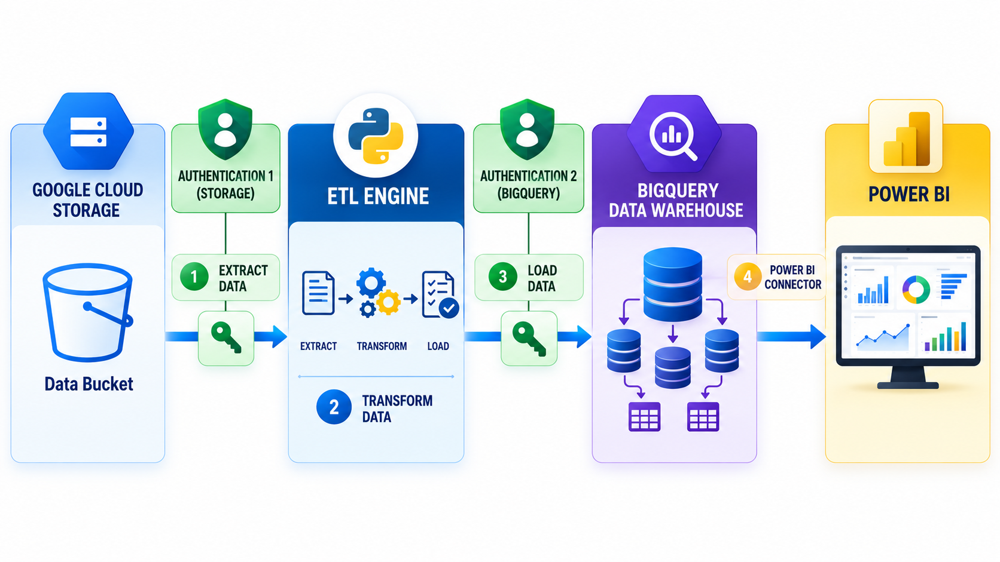
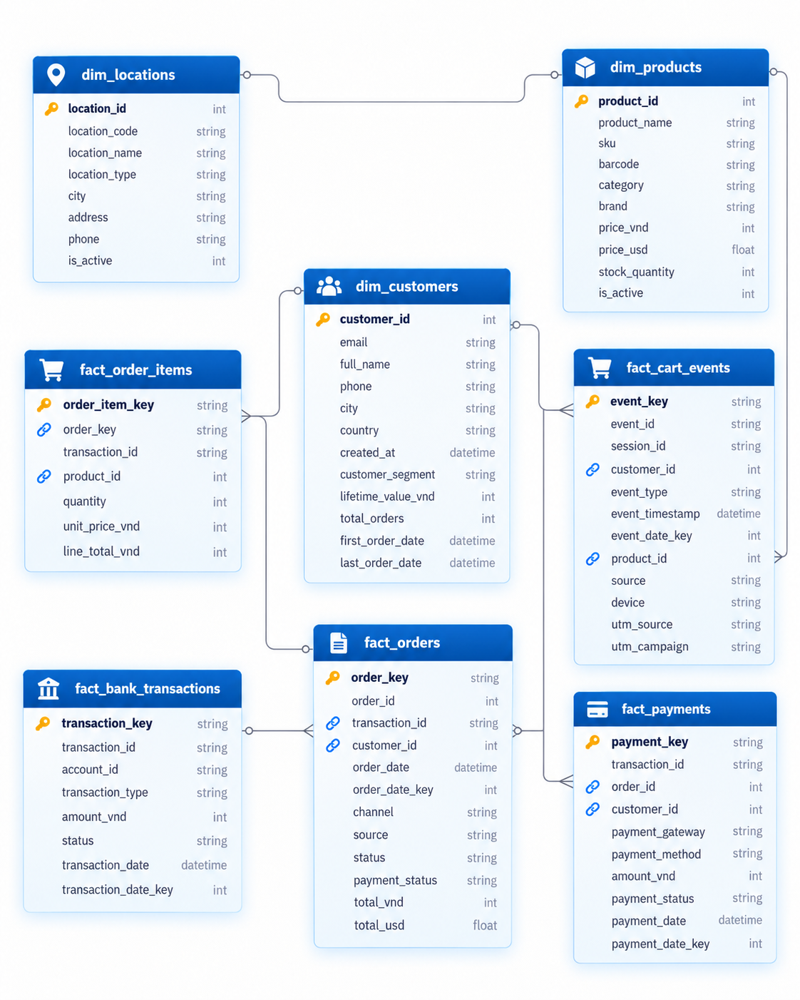
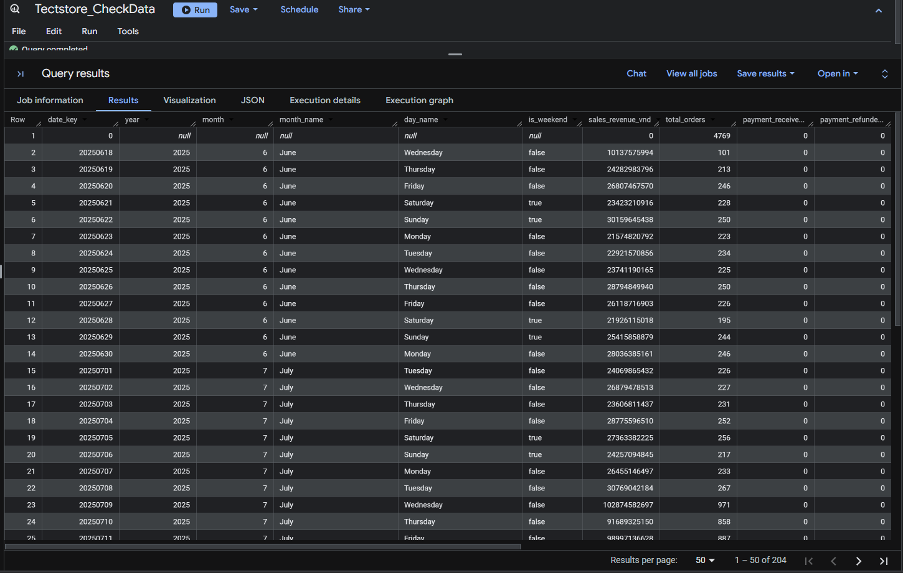
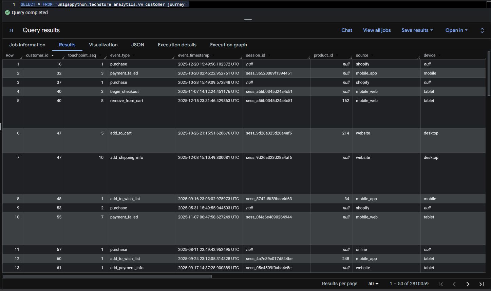
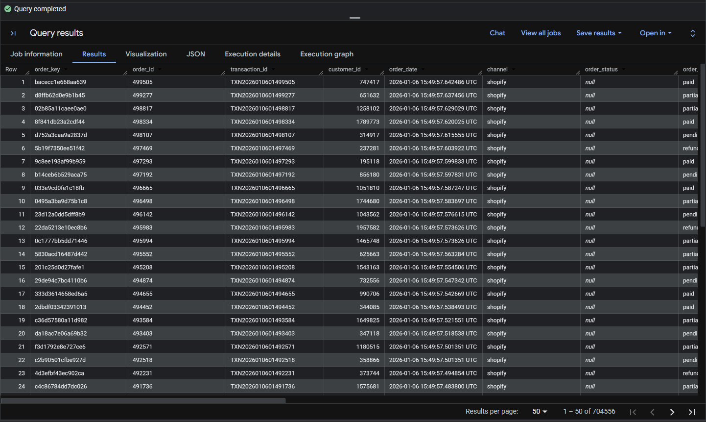
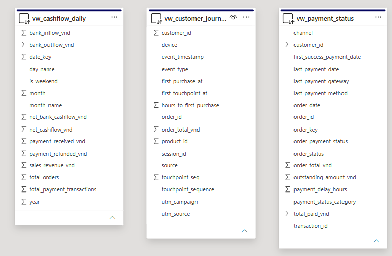

# 🛒 RetailFlow — End-to-End Cloud Data Engineering Pipeline

**A retail data engineering project built with Python, Google Cloud Storage, BigQuery, SQL, and Power BI.**


## 📌 Project Overview

RetailFlow explores a common challenge in retail analytics: **sales, customer activity, and payments are scattered across multiple platforms**. Orders captured online, purchases made in physical stores, and transactions recorded by payment providers do not automatically form a single, consistent dataset.

The pipeline brings these sources together in a central data warehouse, making it easier to study customer behavior, revenue, cash flow, and order payment status.

**Business goal:** Build one analytics-ready view of a multi-channel retail business instead of analyzing each data source separately.

**Technology stack:** Python · Pandas · SQL · Google Cloud Storage (GCS) · Google BigQuery · Power BI

### What the pipeline covers

- **Multi-source ingestion:** Reads compressed JSON datasets from sales systems, payment gateways, bank records, and cart-tracking events.
- **Data transformation:** Cleans fields, handles missing values, aligns date and payment formats, and prepares analytical tables.
- **Data validation:** Checks null values, duplicates, invalid dates, and unusual transaction amounts.
- **Cloud warehousing:** Loads the processed datasets into BigQuery, with partitioning and clustering where configured.
- **Customer analytics:** Uses SQL to calculate RFM-based customer segments and lifetime value.
- **Reporting layer:** Exposes reusable BigQuery views that can be connected to Power BI.

---

## 🏗️ Solution Architecture



The data follows a straightforward **Extract → Transform → Load → Analyze** process:

| Stage | Component | Responsibility |
|---|---|---|
| 1. Extract | Google Cloud Storage + Python | Read source-specific `.json.gz` files from cloud storage. |
| 2. Transform | Python + Pandas | Standardize records, prepare dimensions and facts, and run validation rules. |
| 3. Load | Google BigQuery | Store curated data in analytics-ready tables. |
| 4. Analyze | BigQuery SQL + Power BI | Produce customer, payment, and financial insights. |

GCS and BigQuery use service-account authentication configured through environment variables. The main application coordinates extraction, transformation, loading, and post-load SQL operations.

---

## 📂 Data Sources

The input follows the TechStore Vietnam retail scenario, with **eight source groups** in Google Cloud Storage:

| Source | GCS folder | Data represented |
|---|---|---|
| Shopify | `shopify/` | Online customers, products, and orders |
| Sapo POS | `sapo/` | In-store orders and location records |
| Online Orders | `online_orders/` | Orders from additional online channels |
| PayPal | `paypal/` | Payment transactions |
| MoMo | `momo/` | Digital-wallet payments |
| ZaloPay | `zalopay/` | Digital-wallet payments |
| Mercury Bank | `mercury/` | Bank accounts and transfers |
| Cart Tracking | `cart_tracking/` | Customer interactions and shopping-cart events |

Files are expected in **compressed JSON (`.json.gz`)** format. Each source can have different column names and data structures, which the transformation layer brings into a consistent warehouse model.

A typical sales record may contain an order ID, customer ID, transaction ID, order date, payment status, amount, and nested line items.

For additional column-level details, see [Raw Data Dictionary](raw_data_dictionary.md), if included in your checkout.

---

## ⚙️ How the ETL Pipeline Works

### 1. Extract: Connect to cloud storage

The extraction layer contains a common `Base_Extractor` for interacting with GCS. Source-specific extractors reuse this logic while targeting different folders.

The process is:

1. Authenticate with Google Cloud Storage.
2. Find compressed files within a source folder.
3. Download and decompress the JSON payload.
4. Convert records to Pandas DataFrames for further processing.

**Relevant modules:**

- `extractors/base_extractor.py`
- `extractors/shopify_extractor.py`
- `extractors/sapo_extractor.py`
- `extractors/online_extractor.py`
- `extractors/payment_extractor.py`
- `extractors/tracking_extractor.py`

Mercury Bank data is handled as related account and transaction data rather than a single flat dataset.

### 2. Transform: Prepare reliable analytical data

Once extracted, the records are processed into consistent dimension and fact tables. The transformation utilities support:

| Transformation | Purpose |
|---|---|
| Date conversion | Convert incoming timestamps and handle unparseable dates. |
| Missing-value handling | Fill selected fields with defined defaults. |
| Surrogate/composite keys | Create distinct record identifiers across source systems. |
| Nested data expansion | Convert order line-item arrays into individual rows. |
| Payment normalization | Align gateway-specific status codes to common statuses. |
| Data-quality checks | Identify nulls, duplicates, date issues, and value outliers. |

For example, the payment providers don't all represent success in the same way:

```python
# Payment status standardization in the transformation logic
fact_payment_zalopay['payment_status'] = np.where(
    df['return_code'] == 1, 'SUCCESS', 'FAILED'
)

fact_payment_momo['payment_status'] = np.where(
    df['resultCode'] == 0, 'SUCCESS', 'FAILED'
)
```

These examples are excerpts of the existing transformer logic, not standalone scripts.

**Relevant modules:** `transformers/base_transformer.py`, `dimension_transformer.py`, and `fact_transformer.py`.

### 3. Load: Build the BigQuery warehouse

The `Big_Query_Loader` writes transformed DataFrames into the configured BigQuery dataset. The design supports **partitioning** and **clustering** based on table characteristics.

For example, `fact_orders` is configured with:

```python
self.loader.load_dataframe(
    df=fact_orders,
    dataset_id=self.dataset_id,
    bq_table_name='fact_orders',
    write_disposition='WRITE_TRUNCATE',
    partition_by='order_date_key',
    cluster_by=['customer_id', 'channel']
)
```

**Current loading approach:** `WRITE_TRUNCATE` replaces the destination table during each full refresh. Incremental loads are a possible future extension, but they are not part of this documented workflow.

### 4. Post-load SQL: Customer segmentation

After the order facts are loaded, a BigQuery SQL operation calculates customer-level metrics:

- **Recency:** How recently a customer purchased.
- **Frequency:** How often the customer ordered.
- **Monetary value:** How much the customer spent.

The SQL logic uses window functions such as `NTILE(5)` to generate RFM scores and `MERGE` to update customer attributes. Customers without order history are retained and assigned the **No Purchase** segment.

```sql
SELECT
    customer_id,
    MIN(order_date) AS first_order_date,
    MAX(order_date) AS last_order_date,
    COUNT(DISTINCT order_key) AS total_orders,
    SUM(total_vnd) AS life_time_value_vnd
FROM fact_orders
WHERE payment_status IN ('paid', 'partially_paid')
  AND status IN ('completed', 'shipping', 'delivered', 'fulfilled', 'pending')
GROUP BY customer_id;
```

This query illustrates the customer-level aggregation used in the broader RFM calculation.

### 5. Orchestration and logging

`Pipeline_Orchestrator` manages the order of operations: dimension processing, fact processing, and customer-segmentation SQL. Shared logging utilities record pipeline events and errors to help identify problems during execution.

The project entry point is:

```bash
python main.py
```

---

## 🗄️ Data Warehouse Design



RetailFlow uses a **star-schema-style analytical model** to separate descriptive attributes from transactional events.

### Dimension tables

| Table | Description |
|---|---|
| `dim_customer` | Customer attributes, order history summaries, and RFM segments |
| `dim_product` | Product catalog, categories, brands, and prices |
| `dim_location` | Physical store details and location information |
| `dim_date` | Calendar attributes for date-based analysis |

### Fact tables

| Table | Description |
|---|---|
| `fact_orders` | Orders from online and offline sales channels |
| `fact_order_items` | Product-level details for each order |
| `fact_payments` | Payment gateway transactions |
| `fact_cart_events` | Website and cart interactions |
| `fact_bank_transactions` | Bank inflow and outflow records |

The available source data does not include staff-level details, so a staff dimension is not included in the current implementation.

For schema details, see [Data Dictionary](data_dictionary.md), if present in the repository.

---

## 📊 Analytics and Reporting

The BigQuery reporting layer includes three analytical views aimed at different business questions.

| BigQuery view | Business question |
|---|---|
| `vw_customer_journey` | What interactions led a customer from browsing to purchasing? |
| `vw_cashflow_daily` | How do daily sales, incoming payments, and bank movements compare? |
| `vw_payment_status` | Which orders are paid, pending, overdue, or partially paid? |

### Customer Segmentation


The customer dimension holds RFM-related attributes, including order counts, lifetime value, recent activity, and customer segment labels.

### Daily Cash Flow



This view brings together daily sales, payment collections and refunds, and bank transactions to support finance-oriented reporting.

### Customer Journey



Shopping activity and purchase events are combined into an ordered sequence to help analyze customer touchpoints and conversion behavior.

### Payment Monitoring



Payment records are aggregated against orders to highlight completed payments, outstanding balances, and payment delays.

### Power BI Model



The three reporting views can be accessed through the **native Google BigQuery connector in Power BI**. The images show the reference project's reporting outputs; your own results will depend on the data and GCP configuration used.

---

## 🗂️ Repository Structure

```text
RetailFlow-Data-Engineering-Pipeline/
├── config/                 # Configuration template
├── extractors/             # Read individual source datasets from GCS
├── transformers/           # Data cleaning, dimensions, facts, quality checks
├── loaders/                # BigQuery loading logic
├── orchestration/          # Main ETL workflow
├── utils/                  # Configuration and logging helpers
├── tests/                  # Extraction, transformation, and loading checks
├── Images/                 # Diagrams and output screenshots
├── data_dictionary.md      # Warehouse documentation (where provided)
├── raw_data_dictionary.md  # Source data documentation (where provided)
├── .env.example            # Environment variable template
├── main.py                 # Pipeline entry point
└── requirement.txt         # Python dependencies
```

---

## 🚀 Getting Started

### Prerequisites

- Python 3.8 or later
- Google Cloud project with **Cloud Storage** and **BigQuery** enabled
- GCS bucket containing the expected retail input files
- Google Cloud service-account credentials with suitable access to the bucket and BigQuery dataset

### 1. Clone this repository

```bash
git clone https://github.com/manasi-navale2107/RetailFlow-Data-Engineering-Pipeline.git
cd RetailFlow-Data-Engineering-Pipeline
```

### 2. Install the required libraries

```bash
pip install -r requirement.txt
```

### 3. Configure Google Cloud credentials

Set the environment values expected by the configuration module, for example:

```env
GOOGLE_APPLICATION_CREDENTIALS=path/to/gcs_service_account.json
GOOGLE_APPLICATION_CREDENTIALS_BIGQUERY=path/to/bigquery_service_account.json
```

Keep the actual credential JSON files **out of the GitHub repository**.

### 4. Specify the cloud resources

In `main.py`, set the bucket and dataset to resources in your GCP project:

```python
BUCKET_NAME = 'your-gcs-bucket-name'
DATASET_ID = 'your-bigquery-dataset'
```

### 5. Execute the pipeline

```bash
python main.py
```

Review terminal logs, then check the configured BigQuery dataset for the output tables. The Power BI integration can be set up once the required analytical views are available.

> **Note:** Source data and personal Google Cloud credentials are not automatically supplied by cloning the repository. Cloud usage may incur charges outside free limits.

---

## 🎯 Project Takeaways

RetailFlow demonstrates how Python ETL, cloud storage, and SQL-based warehousing can work together in one retail analytics workflow. The design focuses on consolidating different source formats, validating records, modeling transactional data, and exposing reusable views for reporting.

**Possible future extensions:** Incremental ingestion, automated pipeline scheduling, automated test coverage, and additional data sources.

---

### Reference and Acknowledgment

Adapted for the **RetailFlow** portfolio project from the publicly available [TechStore Vietnam end-to-end retail pipeline](https://github.com/TascoGitGud/Building-an-End-to-end-Retail-Data-Pipeline-for-Techstore-Vietnam). The pipeline architecture and existing implementation are based on that reference; this README uses revised presentation and project branding.
